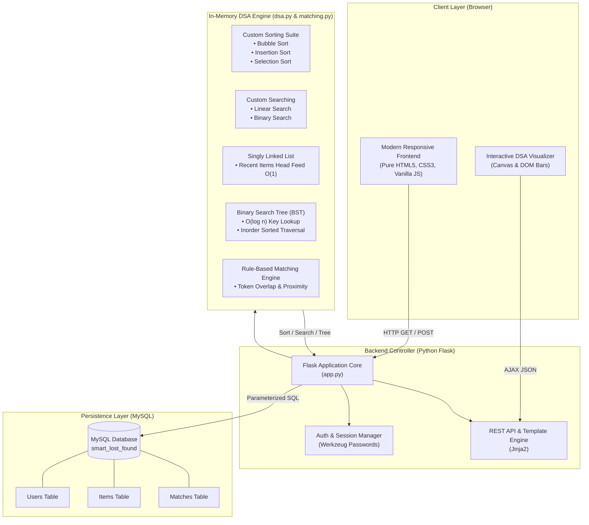
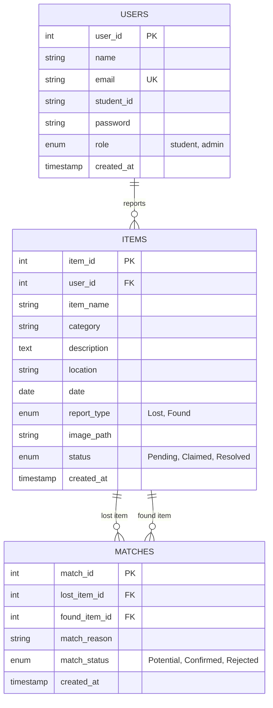

# 🎒 Smart Lost & Found System - Campus Recovery Portal

[](https://python.org)
[](https://flask.palletsprojects.com)
[](https://mysql.com)
[]()
[]()

> A full-stack, enterprise-grade Lost & Found Web Application tailored for university campuses. Built strictly with **Vanilla HTML/CSS/JavaScript**, **Python Flask**, **MySQL**, and **native manual implementations** of fundamental Data Structures & Algorithms (Arrays, Singly Linked List, Binary Search Tree, Linear & Binary Search, Bubble, Insertion, and Selection Sort).

---

## 📑 Table of Contents

1. [Project Abstract & Problem Statement](#-project-abstract--problem-statement)
2. [Objectives, Scope & Methodology](#-objectives-scope--methodology)
3. [Strict Technology Stack](#-strict-technology-stack)
4. [System Architecture Diagram](#-system-architecture-diagram)
5. [Database ER Diagram & Schema](#-database-er-diagram--schema)
6. [Data Structures & Algorithms (DSA) Implementation](#-data-structures--algorithms-dsa-implementation)
7. [Deterministic Matching Engine](#-deterministic-matching-engine)
8. [Two-Member Team Work Division](#-two-member-team-work-division)
9. [Project Folder Structure](#-project-folder-structure)
10. [Installation & Execution Guide](#-installation--execution-guide)
11. [Test Cases & Expected Outputs](#-test-cases--expected-outputs)
12. [Project Demonstration Script](#-project-demonstration-script)
13. [Comprehensive Viva Questions & Answers](#-comprehensive-viva-questions--answers)
14. [Conclusion & Future Enhancements](#-conclusion--future-enhancements)

---

## 📝 Project Abstract & Problem Statement

### Abstract
On modern university campuses with thousands of active students and faculty, misplaced items (laptops, student ID cards, wallets, notebooks, and electronics) are a daily occurrence. The conventional recovery process relies on fragmented WhatsApp groups, noticeboards, or disorganized security desks, leading to low recovery rates and significant student anxiety.

The **Smart Lost & Found System** provides a centralized, automated web platform that allows students to report lost belongings or register discovered articles. Behind the clean user interface lies a dedicated **Data Structures & Algorithms (DSA) execution engine** written purely from scratch in Python, implementing custom search algorithms, sort routines, linked list feeds, and binary search tree indices to achieve rapid information retrieval and deterministic item pairing.

### Problem Statement
Current lost-and-found practices suffer from:
1. **Information Asymmetry:** A student who lost an item often has no centralized directory to search if someone has already found and handed it in.
2. **Lack of Automated Correlation:** No mechanism exists to pair matching reports automatically based on attributes like location, date, category, and descriptive keywords.
3. **Absence of Algorithmic Efficiency:** Basic implementations rely on unindexed, linear database queries that do not scale and offer zero educational insight into computational complexity.

---

## 🎯 Objectives, Scope & Methodology

### Objectives
- Develop an end-to-end, functional full-stack web application for college campuses.
- Write manual Python implementations of:
  - **Bubble Sort**, **Insertion Sort**, and **Selection Sort** (with step counters).
  - **Linear Search** and **Binary Search** (with interval tracking).
  - **Singly Linked List** (O(1) recent activity stream).
  - **Binary Search Tree** (O(log n) report index by Item ID with inorder sorted traversal).
- Construct an algorithmic rule-based matching engine comparing Lost vs Found records.
- Create an interactive **DSA Visualizer** demonstrating these mechanics in real-time.

### Scope
- **Target Audience:** College students, campus security officers, and laboratory administrators.
- **Campus Boundaries:** Specific college locations (e.g. Central Library, Computer Labs, Cafeteria, Auditorium, Sports Complex).
- **Security Scope:** Session-based authentication, salted password hashing with Werkzeug, role-based authorization (Student vs Admin), and safe parameterized database operations.

### Methodology
1. **Iterative Waterfall Model:** Requirements gathering $\to$ Schema design $\to$ DSA module development $\to$ Backend routing $\to$ UI styling $\to$ Integration & verification.
2. **Algorithmic Transparency:** Rather than using black-box libraries (`numpy`, `sklearn`, or built-in `sort()`), all core computational steps are manually coded with step telemetry.

---

## 🛠️ Strict Technology Stack

| Layer | Technology | Purpose | Constraints & Justifications |
| :--- | :--- | :--- | :--- |
| **Frontend** | HTML5, Pure CSS3, Vanilla JavaScript | Responsive user interface, forms, animations | **No React, Angular, Vue, Bootstrap, or Tailwind**. Pure bespoke CSS for authentic frontend craftsmanship. |
| **Backend** | Python 3.10+ & Flask | Request handling, session security, DSA execution | **No Node.js, PHP, Java, or Django**. Lightweight, readable, and ideal for DSA demonstration. |
| **Database** | MySQL (PyMySQL / mysql-connector) | Persistent storage of Users, Items, and Matches | **No SQLite, MongoDB, or Firebase**. Relational tables with foreign key constraints. |
| **DSA** | Native Python Classes & Functions | In-memory indexing, sorting, searching, linked feeds | **No built-in sort() or bisect**. All data structures built manually. |

---

## 🏛️ System Architecture Diagram



---

## 🗄️ Database ER Diagram & Schema



### Table Specifications:
1. **Users:** Stores student & administrator credentials, student ID/roll numbers, and hashed passwords.
2. **Items:** Stores all campus lost & found reports with category, dates, descriptions, locations, status flags, and optional photo paths.
3. **Matches:** Records deterministic correspondence links between pairs of lost and found items along with human-readable reasoning strings.

---

## 🧠 Data Structures & Algorithms (DSA) Implementation

Every algorithm is written manually in `dsa.py` without built-in libraries.

### 1. Arrays
- **Implementation:** Python list of dictionaries mapping MySQL record rows.
- **Application:** Acts as the base linear sequence for sorting passes and multi-criteria searches.

### 2. Custom Sorting Algorithms
| Algorithm | Best Time | Average Time | Worst Time | Space | Campus Use Case |
| :--- | :--- | :--- | :--- | :--- | :--- |
| **Bubble Sort** | $O(n)$ | $O(n^2)$ | $O(n^2)$ | $O(1)$ | Applied with an early-exit `swapped` flag to sort item lists alphabetically by `item_name`. |
| **Insertion Sort** | $O(n)$ | $O(n^2)$ | $O(n^2)$ | $O(1)$ | Organizes incoming daily reports chronologically by `date`. Extremely fast for incremental updates. |
| **Selection Sort** | $O(n^2)$ | $O(n^2)$ | $O(n^2)$ | $O(1)$ | Used when minimizing memory swaps is critical. Sorts records by unique `item_id`. |

### 3. Custom Searching Algorithms
- **Linear Search ($O(n)$):** Checks each item sequentially across multiple attributes (`item_name`, `category`, `location`, `description`). Ideal for arbitrary keyword searches across unsorted data.
- **Binary Search ($O(\log n)$):** First sorts records by `item_id`, then recursively/iteratively halves the search space via `mid = (low + high) // 2`. Used for instantaneous lookup of an item by its numerical report ID.

### 4. Singly Linked List
- **Classes:** `Node(data, next)`, `SinglyLinkedList(head)`.
- **Operations:**
  - `insert_head(data)`: $O(1)$ time complexity.
  - `insert_tail(data)`: $O(n)$ time complexity.
  - `delete_by_id(item_id)`: $O(n)$ traversal deletion.
  - `get_recent(limit)`: Fast retrieval of top $N$ recently submitted lost/found items for the home page feed without array shifts.

### 5. Binary Search Tree (BST)
- **Classes:** `BSTNode(key, data, left, right)`, `BinarySearchTree(root)`.
- **Operations:**
  - `insert(item, key)`: Average $O(\log n)$, Worst $O(n)$.
  - `search(key)`: Average $O(\log n)$ search by Item ID.
  - `delete(key)`: Deletion handling 0, 1, and 2 children (via inorder successor).
  - `inorder_traversal()`: Always yields items in strictly ascending numerical order ($O(n)$).

---

## ⚡ Deterministic Matching Engine

The module `matching.py` detects correlations without AI/ML:
$$\text{Score} = S_{\text{category}} (30) + S_{\text{keywords}} (35) + S_{\text{location}} (20) + S_{\text{date}} (15)$$

- **Category Match (30 pts):** Requires exact or compatible categorization.
- **Keyword & Description Overlap (35 pts):** Tokenizes text strings, purges campus stop words (`in`, `on`, `at`, `lost`), and computes token set intersections.
- **Location Match (20 pts):** Matches exact venue or campus area tokens (e.g. `Computer Lab 3`, `Library`).
- **Date Proximity (15 pts):** Verifies that the discovery date is plausibly on or after the loss date (within a 14-day window).
- **Match Threshold:** A score $\ge 45$ triggers an automatic candidate entry in the `Matches` table with human-readable rationale.

---

## 👥 Two-Member Team Work Division

| Team Member | Primary Domain | Core Responsibilities & Modules |
| :--- | :--- | :--- |
| **Member 1**<br>*(Frontend & Database Lead)* | **UI/UX & MySQL Storage** | • Designed all 11 responsive HTML templates.<br>• Crafted pure CSS stylesheet (`style.css`) without frameworks.<br>• Built vanilla JavaScript validations and image previews.<br>• Designed MySQL database schema (`schema.sql`) with tables, FKs, and sample records.<br>• Authored the interactive visualizer UI frontend. |
| **Member 2**<br>*(Backend & DSA Lead)* | **Flask Server & DSA Engine** | • Programmed Flask backend application routes (`app.py`).<br>• Implemented all manual DSA algorithms in `dsa.py` (Bubble, Insertion, Selection Sort, Linear & Binary Search, Singly Linked List, BST).<br>• Developed the deterministic matching system (`matching.py`).<br>• Handled session security, password hashing, and admin controls.<br>• Connected Flask with MySQL (`database.py`). |
| **Joint Collaboration**<br>*(Both Members)* | **Integration & Defense** | • End-to-end testing and verification suite (`test_system.py`).<br>• Documentation, architecture diagrams, and viva preparation.<br>• Real-time campus demonstration walkthrough. |

---

## 📂 Project Folder Structure

```
smart_lost_found/
├── app.py                  # Core Flask web application & route handlers
├── database.py             # MySQL connector, parameterized queries & fallback
├── dsa.py                  # Native implementations of Sorting, Search, LL & BST
├── matching.py             # Rule-based matching engine
├── schema.sql              # MySQL database schema & sample data insertion
├── requirements.txt        # Python dependency specifications
├── test_system.py          # Automated verification test suite
├── README.md               # Complete academic documentation & viva guide
├── uploads/                # Directory for uploaded item photographs
├── templates/              # Jinja2 HTML templates (100% bespoke)
│   ├── base.html           # Master layout with responsive navbar & footer
│   ├── index.html          # Home page with Linked List feed & search
│   ├── login.html          # Secure login form with demo credentials
│   ├── register.html       # Student registration with client validation
│   ├── report_lost.html    # Lost item submission form + photo preview
│   ├── report_found.html   # Found item submission form + photo preview
│   ├── search.html         # Multi-criteria search with DSA telemetry
│   ├── matches.html        # Side-by-side matching results display
│   ├── my_reports.html     # Student submitted reports tracker
│   ├── item_details.html   # Complete item view, BST telemetry & contact
│   ├── admin.html          # Admin management dashboard & status controls
│   └── dsa_visualizer.html # Interactive DSA animation workbench
└── static/
    ├── css/
    │   └── style.css       # Pure modern CSS (Variables, Flexbox, Grid)
    ├── js/
    │   └── script.js       # Client validation, image preview, & DSA canvas
    └── images/             # Static UI icons and assets
```

---

## 🚀 Installation & Execution Guide

### Prerequisites
- Python 3.10 or higher installed.
- MySQL Server or XAMPP / MariaDB installed (optional; system features an automated fallback engine if MySQL is temporarily offline).

### Step 1: Open Terminal in Project Folder
```bash
cd "smart_lost_found"
```

### Step 2: Install Dependencies
```bash
pip install -r requirements.txt
```

### Step 3: Configure Database (MySQL / XAMPP)
1. Start Apache & MySQL in the XAMPP Control Panel (or start your local MySQL service).
2. Open phpMyAdmin (`http://localhost/phpmyadmin`) or your MySQL CLI.
3. Import the `schema.sql` script:
```bash
mysql -u root -p < schema.sql
```
*(Default DB configurations: host=`localhost`, user=`root`, password=``, db=`smart_lost_found`). You can override credentials via environment variables `DB_HOST`, `DB_USER`, `DB_PASSWORD` if required.*

### Step 4: Run Verification Tests
```bash
python -m unittest test_system.py
```
*All 6 test suites will execute and display `OK`.*

### Step 5: Start the Flask Application
```bash
python app.py
```
Open your web browser and navigate to:
```
http://127.0.0.1:5000
```

---

## 🧪 Test Cases & Expected Outputs

| Test ID | Module | Input / Action | Expected Output | Status |
| :--- | :--- | :--- | :--- | :--- |
| **TC-01** | `dsa.py` | Bubble Sort list of 3 items by `item_name` | Sorted alphabetically: `Apple Charger`, `MacBook Pro`, `Zebra Pen` | ✅ Passed |
| **TC-02** | `dsa.py` | Insertion Sort list by `date` | Sorted chronologically: `2026-10-28`, `2026-10-30`, `2026-11-01` | ✅ Passed |
| **TC-03** | `dsa.py` | Selection Sort list by `item_id` | Sorted numerically: `2`, `5`, `8` with at most $n$ swaps | ✅ Passed |
| **TC-04** | `dsa.py` | Linear Search for keyword `"Laptop"` | Matches item #25 (`Dell Laptop`), returns comparisons count | ✅ Passed |
| **TC-05** | `dsa.py` | Binary Search for numerical ID `25` | Returns item record in $O(\log n)$ comparisons with step history | ✅ Passed |
| **TC-06** | `dsa.py` | Singly Linked List: Insert 2 items at Head | Most recent item becomes the new HEAD ($O(1)$) | ✅ Passed |
| **TC-07** | `dsa.py` | BST Inorder Traversal on keys `[50, 30, 70, 20]` | Strict sorted array: `[20, 30, 50, 70]` | ✅ Passed |
| **TC-08** | `matching.py`| Compare Lost `Dell XPS Laptop` vs Found `Dell Laptop` in `Lab 3` | Match confirmed ($\text{Score} \ge 60$) with descriptive rationale | ✅ Passed |
| **TC-09** | `app.py` | POST `/login` with `aarav.sharma@campus.edu` / `password123` | Session created, redirected to home page with student profile | ✅ Passed |
| **TC-10** | `app.py` | POST `/report-lost` with valid item details | Item saved to DB, auto-matching executed, redirected with flash message | ✅ Passed |

---

## 🎬 Project Demonstration Script

Follow this step-by-step walkthrough to present the project to evaluators:

1. **Introduction & Home Feed (2 Mins):**
   - Open `http://127.0.0.1:5000`.
   - Point out the clean campus navigation bar, recovery statistics counters, and the **Recently Reported Items** section.
   - *Evaluator note:* Explain that the home feed items are served from the **Singly Linked List** in $O(1)$ head retrieval.

2. **Student Authentication & Reporting (3 Mins):**
   - Click **Login** and sign in using: `aarav.sharma@campus.edu` / `password123`.
   - Navigate to **Report Lost Item**.
   - Enter:
     - Name: `iPad Air with Black Smart Folio`
     - Category: `Electronics`
     - Date: Current date
     - Location: `Central Library 1st Floor`
     - Description: `Space grey iPad with chemistry notes stickers.`
   - Submit the report. Notice the flash confirmation and instant redirection.

3. **Advanced Search & Sorting Showcase (3 Mins):**
   - Open **Search Items**.
   - Type `"Dell"` in the search bar.
   - Select **Linear Search** and **Bubble Sort** by `item_name`.
   - Show the **DSA Execution Benchmark Banner** displaying exact comparisons count and execution time in milliseconds.
   - Change search algorithm to **Binary Search** and enter an Item ID (e.g. `1` or `2`) to demonstrate $O(\log n)$ lookup.

4. **Automated Matching Engine (2 Mins):**
   - Click on the **Matches** tab in the navigation bar.
   - Show the side-by-side comparison cards: Lost item on the left (red border), Found item on the right (green border), with match score badge and human-readable reasoning strings.

5. **DSA Visualizer Workbench (3 Mins):**
   - Click on **DSA Visualizer**.
   - **Tab 1 (Sorting):** Select `Bubble Sort` and click `Run Sort`. Watch the animated bars turn yellow (comparing), red (swapping), and green (sorted).
   - **Tab 2 (Searching):** Demonstrate step-by-step pointers for Linear vs Binary Search.
   - **Tab 3 (Linked List):** Click `+ Insert at Head` and observe $O(1)$ node insertion.
   - **Tab 4 (BST):** Show the graphical tree on canvas. Search for an ID and watch the search traversal path highlight. Click `Inorder Traversal` to prove sorted output.

6. **Admin Dashboard (2 Mins):**
   - Log out and log in as Administrator: `admin@campus.edu` / `password123`.
   - Access **Admin Panel**. Demonstrate updating item statuses (`Pending` $\to$ `Claimed` $\to$ `Resolved`) and removing duplicate reports.

---

## 🎓 Comprehensive Viva Questions & Answers

### Q1: Why did you choose Python Flask instead of Django or Node.js?
> **Answer:** Flask is a minimalist WSGI micro-framework that gives complete control over request handling and architecture without unnecessary ORM overhead. This allowed us to integrate custom, manual Data Structures & Algorithms directly into the request-response lifecycle rather than relying on high-level framework abstractions.

### Q2: Why is Bubble Sort considered an $O(n^2)$ algorithm, and how did you optimize it?
> **Answer:** Bubble sort uses two nested loops: an outer pass loop running $n$ times and an inner adjacent comparison loop running $n - i - 1$ times, yielding $\frac{n(n-1)}{2}$ comparisons in the worst case ($O(n^2)$). We optimized it using a boolean `swapped` flag. If a complete pass finishes without a single swap, the list is already sorted, terminating early in $O(n)$ best-case time.

### Q3: When is Insertion Sort preferable over Selection Sort and Bubble Sort?
> **Answer:** Insertion Sort is adaptive and online. If data arrives continuously (such as lost item reports filed one by one throughout a day), Insertion Sort inserts each new element into an already sorted list in $O(n)$ time. Additionally, for nearly-sorted lists, its runtime approaches $O(n)$, whereas Selection Sort strictly executes $O(n^2)$ comparisons regardless of initial order.

### Q4: Why is Selection Sort useful if its time complexity is always $O(n^2)$?
> **Answer:** Selection Sort performs at most $O(n)$ write (swap) operations because it only swaps after locating the absolute minimum of the unsorted partition. In systems where memory write cycles are costly (e.g., flash memory or constrained EEPROMs), Selection Sort is preferable to Bubble Sort which performs up to $O(n^2)$ swaps.

### Q5: What is the fundamental prerequisite for Binary Search?
> **Answer:** The array must be sorted monotonically on the search key. In our system, when a user requests a Binary Search by `item_id`, we first sort the array using our custom sorting algorithm before applying iterative division of the search space.

### Q6: What is the time complexity of searching a Binary Search Tree (BST)?
> **Answer:** In a balanced or average BST, the search time complexity is $O(\log n)$ because each comparison halves the remaining subtree. In the worst case (a degenerate or skewed tree where elements are inserted in strictly ascending or descending order), the tree behaves like a linked list with $O(n)$ search time.

### Q7: What is the significance of Inorder Traversal in a Binary Search Tree?
> **Answer:** Inorder Traversal follows the sequence **Left Subtree $\to$ Root $\to$ Right Subtree**. By the fundamental definition of a BST (all left descendants $<$ root $<$ all right descendants), visiting nodes in this order guaranteed to yield all keys in strictly ascending sorted order in $O(n)$ time.

### Q8: How does your Singly Linked List benefit the "Recently Reported Items" feed?
> **Answer:** In a fixed or contiguous array, prepending a newly submitted report to index 0 requires shifting all existing $n$ items to the right ($O(n)$ overhead). With a Singly Linked List, inserting at the head simply creates a new node, points its `next` pointer to the current `head`, and updates `head` in constant $O(1)$ time.

### Q9: How does the matching algorithm correlate lost and found items without AI?
> **Answer:** It uses a weighted deterministic heuristic:
> 1. Exact Category matching (+30 pts).
> 2. Tokenized Keyword intersection between item names & descriptions (+35 pts).
> 3. Campus Location token overlap (+20 pts).
> 4. Date plausibility (+15 pts).
> A composite score $\ge 45$ indicates a probable match and records it into the `Matches` table.

### Q10: How do you prevent SQL Injection in your database operations?
> **Answer:** We use parameterized queries (prepared statements) with placeholder parameters (`%s`). User inputs are never concatenated directly into SQL strings. The MySQL driver automatically escapes and treats parameters purely as literals, preventing arbitrary SQL execution.

### Q11: How are student passwords protected?
> **Answer:** Passwords are never stored in plaintext. We utilize Werkzeug's `generate_password_hash()`, which uses the cryptographic `scrypt` hashing algorithm with salt and high memory-cost parameters, effectively preventing dictionary and rainbow-table attacks.

### Q12: What role-based access controls exist in the application?
> **Answer:** Users have a `role` field in the `Users` table (`student` or `admin`). Flask decorators (`@login_required` and `@admin_required`) check the active `session`. Ordinary students cannot access `/admin`, change arbitrary report statuses, or delete other users' records.

---

## 🏁 Conclusion & Future Enhancements

The **Smart Lost & Found System** successfully illustrates the convergence of classical Computer Science foundations and modern full-stack web engineering. Developed by a team of two BTech CSE students, it bridges theoretical DSA concepts (Arrays, Search algorithms, Sort routines, Linked Lists, and BSTs) with real-world campus utility.

### Future Scope:
- Integration of campus email notifications (SMTP) when a potential match is identified.
- QR-code generation for high-value student items (laptops, cycle keys) to expedite lost & found resolution.
- AVL or Red-Black self-balancing tree rotation logic to guarantee strict $O(\log n)$ BST operations regardless of insertion sequence.
